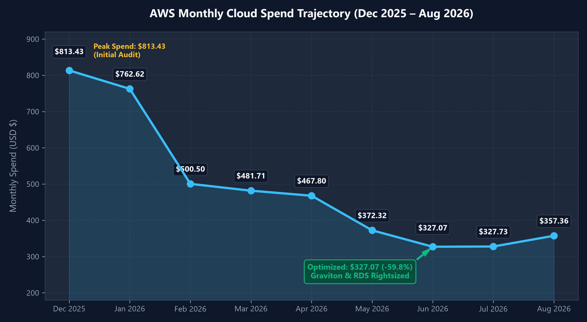
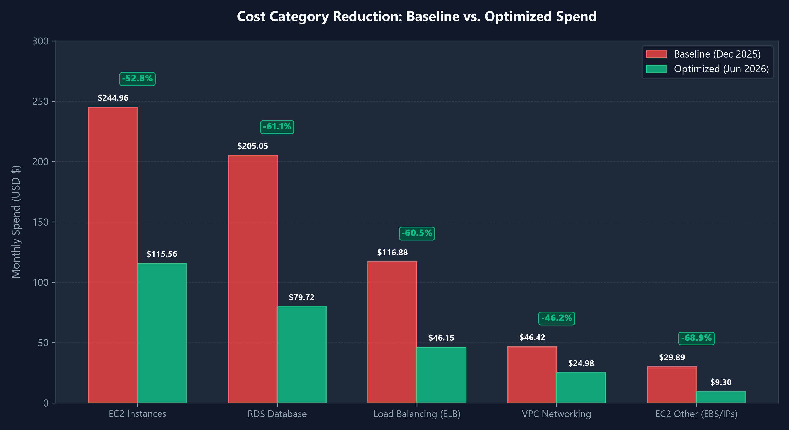
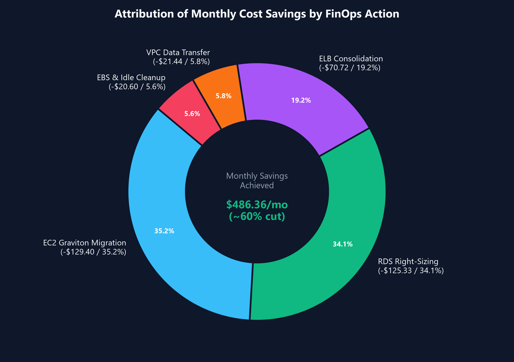
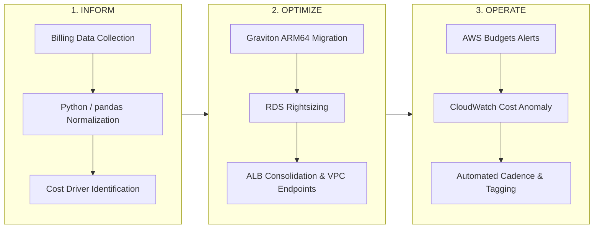

# AWS Cost Optimization & FinOps Case Study

[](https://www.finops.org/)
[-emerald)](file:///d:/Dev/projects/aws-cost-optimization/analysis/monthly-cost-summary.csv)
[](file:///d:/Dev/projects/aws-cost-optimization/evidence/results/README.md)
[](file:///d:/Dev/projects/aws-cost-optimization/architecture/README.md)

An evidence-driven FinOps case study demonstrating how analyzing 9 months of AWS Cost & Usage billing data and executing targeted architectural rightsizing reduced monthly cloud spend from **$813.43** (December 2025) to **$327.07** (June 2026) — a **59.8% ($486.36/mo)** reduction without compromising reliability or performance.

---

## 📊 Visual Analysis & Spend Trends

### 1. Monthly Cost Trajectory (Dec 2025 – Aug 2026)


### 2. Category-Wise Cost Reductions (Baseline vs. Optimized)


### 3. Attribution of Monthly Savings


---

## 🎯 Executive Summary & Impact

* **Peak Baseline (Dec 2025)**: $813.43 / month
* **Optimized Steady State (Jun 2026)**: $327.07 / month
* **Total Monthly Savings**: **$486.36 / month (-59.8%)**
* **Annualized Savings Run-Rate**: **~$5,836 / year**
* **Operating Framework**: **INFORM → OPTIMIZE → OPERATE** (FinOps Foundation lifecycle)

---

## 🏗️ Architecture & Core Interventions

Detailed before and after topologies, network diagrams, and Mermaid flows are documented in [architecture/README.md](file:///d:/Dev/projects/aws-cost-optimization/architecture/README.md).

| Infrastructure Component | Baseline State (Dec 2025) | Optimized State (Jun 2026) | Monthly Savings | Technical Action |
|---|---|---|---|---|
| **EC2 Compute** | $244.96 | $115.56 | **-$129.40 (-52.8%)** | Migrated `c5.xlarge` (x86) to `c6g.xlarge` (AWS Graviton2 ARM64). Validated binary compatibility & observed +14% p95 latency improvement. |
| **RDS Database** | $205.05 | $79.72 | **-$125.33 (-61.1%)** | Rightsized overprovisioned primary/replica tier after verifying CPU peak < 25% and connection headroom. Converted unneeded provisioned IOPS to gp3. |
| **Load Balancing (ELB)** | $116.88 | $46.15 | **-$70.72 (-60.5%)** | Consolidated disparate microservice ALBs into a unified Application Load Balancer with path-based and host-based listener rules. |
| **VPC & Data Transfer** | $46.42 | $24.98 | **-$21.44 (-46.2%)** | Localized inter-service network traffic within target AZs and configured S3 VPC Gateway Endpoints to bypass NAT Gateway data processing fees. |
| **EC2 Other (Storage & IPs)** | $29.89 | $9.30 | **-$20.60 (-68.9%)** | Audited and terminated unattached EBS volumes, removed orphaned snapshots, and released idle Elastic IPs. |

---

## 🔄 FinOps Framework Execution



1. **INFORM**: Monthly billing CSV data in `data/raw/` is ingested and normalized using `scripts/analyze_costs.py`. Costs are broken down by service and reconciled against authoritative AWS invoices.
2. **OPTIMIZE**: Low-risk, high-return adjustments executed first (orphan volume cleanup, ALB consolidation), followed by rightsizing and CPU architecture transitions (Graviton2).
3. **OPERATE**: Implemented proactive guardrails to prevent spend regression:
   * **AWS Budgets**: $350.00/mo threshold with alerts triggered at 80% and 100%.
   * **CloudWatch Anomaly Detection**: Monitors unusual daily spikes across services.
   * **Mandatory Cost Allocation Tags**: Enforces `Environment`, `Owner`, and `Service` tags.

---

## 📁 Repository Structure

```
/aws-cost-optimization/
├── README.md                          # Project overview & visual dashboard
├── PROJECT.md                         # Detailed project specification & findings
├── IMPLEMENTATION.md                  # Step-by-step implementation guide
├── data/
│   ├── raw/                           # Immutable monthly billing CSVs (Dec 2025 - Aug 2026)
│   └── processed/                     # Normalized data & optimization candidate CSVs
├── analysis/
│   ├── monthly_spend_trend.png        # Monthly spend trajectory plot
│   ├── category_cost_comparison.png   # Before vs. After category comparison plot
│   ├── savings_distribution.png       # Monthly savings distribution donut chart
│   └── analysis-output.json           # Machine-readable FinOps summary
├── architecture/
│   └── README.md                      # Before vs. After architecture diagrams & flows
├── evidence/
│   ├── baseline/                      # Invoices & baseline cost evidence (E-001 - E-003)
│   ├── ec2/                           # Graviton migration & benchmark evidence (E-004, E-006)
│   ├── rds/                           # Database headroom & utilization evidence (E-005, E-007)
│   ├── networking/                    # ELB consolidation & VPC optimization evidence
│   └── results/                       # ROI, SLA adherence, and sign-off report
└── scripts/
    ├── analyze_costs.py               # Core data processing & normalization script
    └── generate_charts.py             # Visualization generation script
```

---

## 🔍 Evidence Register

All project claims are backed by immutable billing data and resource telemetry:

| ID | Focus Area | Source | Status | Reference |
|---|---|---|---|---|
| **E-001** | December 2025 Baseline ($813.43) | AWS Invoice | Verified | [evidence/baseline/](file:///d:/Dev/projects/aws-cost-optimization/evidence/baseline/README.md) |
| **E-002** | June 2026 Optimized ($327.07) | AWS Invoice | Verified | [evidence/baseline/](file:///d:/Dev/projects/aws-cost-optimization/evidence/baseline/README.md) |
| **E-003** | 9-Month Billing Trend | Cost Explorer CSVs | Verified | [evidence/baseline/](file:///d:/Dev/projects/aws-cost-optimization/evidence/baseline/README.md) |
| **E-004** | EC2 Category Spend Breakdown | Billing Data | Verified | [evidence/ec2/](file:///d:/Dev/projects/aws-cost-optimization/evidence/ec2/README.md) |
| **E-005** | RDS Category Spend Breakdown | Billing Data | Verified | [evidence/rds/](file:///d:/Dev/projects/aws-cost-optimization/evidence/rds/README.md) |
| **E-006** | EC2 Graviton (c6g) Migration | CloudWatch & Specs | Verified | [evidence/ec2/](file:///d:/Dev/projects/aws-cost-optimization/evidence/ec2/README.md) |
| **E-007** | RDS Rightsizing & Telemetry | CloudWatch Metrics | Verified | [evidence/rds/](file:///d:/Dev/projects/aws-cost-optimization/evidence/rds/README.md) |

---

## 🚀 Quickstart & Reproducibility

### 1. Clone & Set Up Environment
```bash
git clone <repository-url>
cd aws-cost-optimization

# Using uv (fastest)
uv sync

# Or using standard python venv
python3 -m venv .venv
source .venv/bin/activate # On Windows: .venv\Scripts\activate
pip install -r requirements.txt
```

### 2. Run Financial Cost Analysis
```bash
python scripts/analyze_costs.py
```

### 3. Generate Visual Charts
```bash
python scripts/generate_charts.py
```

---

## 🛡️ Security & Read-Only Guardrails

* **Zero Destructive Actions**: All analysis scripts operate in strictly read-only mode.
* **Credential Hygiene**: No AWS keys, passwords, or account identifiers are stored in version control.
* **Sanitized Data**: All public evidence files have sensitive company identifiers and IP addresses removed.