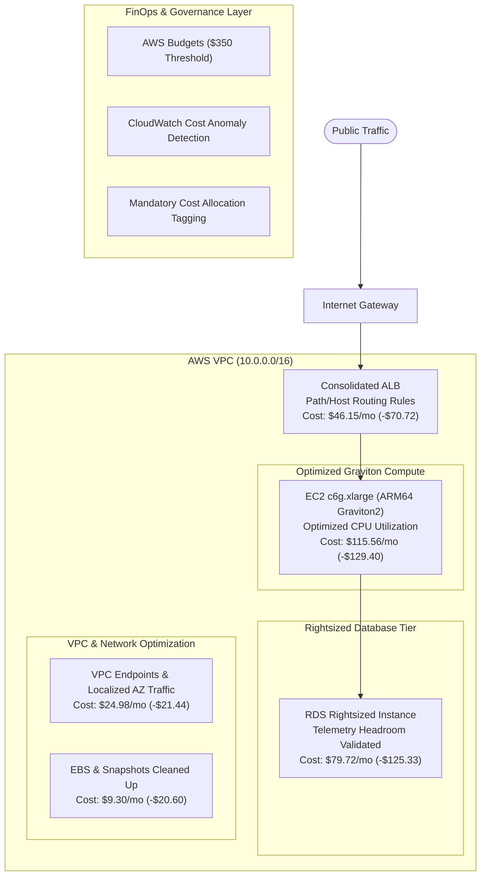

# Architecture: Before vs. After Optimization

This document outlines the cloud infrastructure topology before and after the FinOps cost optimization initiative, highlighting key changes in compute, database, load balancing, and network traffic.

---

## 1. High-Level Summary of Architectural Changes

| Layer | Baseline Architecture (Dec 2025) | Optimized Architecture (Jun 2026) | Engineering Justification |
|---|---|---|---|
| **Compute (EC2)** | `c5.xlarge` (x86_64 Intel Xeon) | `c6g.xlarge` (AWS Graviton2 ARM64) | 40% better price/performance; validated ARM64 binaries & dependencies. |
| **Database (RDS)** | Overprovisioned Multi-AZ database cluster | Right-sized instance tier with optimized storage | Telemetry showed peak CPU < 25% and connection pool underutilization. |
| **Load Balancing (ELB)** | Multiple legacy/redundant ALBs | Consolidated Application Load Balancer with host/path routing rules | Eliminated hourly base instance charges of idle/low-traffic ALBs. |
| **Networking (VPC)** | Cross-AZ inter-service chatter & NAT routing | Single-AZ aligned internal traffic & VPC Gateway Endpoints | Eliminated cross-AZ data transfer fees and reduced NAT gateway data processing. |
| **FinOps Governance** | No automated budget alerts or anomaly triggers | AWS Budgets, CloudWatch anomaly detection & mandatory tagging | Immediate notifications upon unexpected spend spikes; prevents regression. |

---

## 2. Before Optimization Topology (December 2025 — $813.43/mo)

In the initial state, services were provisioned with generous margins, legacy x86 compute instances, redundant load balancers, and unoptimized cross-AZ network paths.

```mermaid
graph TD
    User([Public Traffic]) --> IGW[Internet Gateway]
    IGW --> ALB1[ALB 1: Web App<br/>$25/mo + LCU]
    IGW --> ALB2[ALB 2: Internal/API<br/>$25/mo + LCU]

    subgraph VPC["AWS VPC (10.0.0.0/16)"]
        subgraph AZ1["Availability Zone A"]
            EC2_A["EC2 c5.xlarge (x86_64)<br/>Avg CPU: 18%<br/>Cost: $122.48/mo"]
            NAT_A["NAT Gateway A<br/>$32/mo + processing"]
        end

        subgraph AZ2["Availability Zone B"]
            EC2_B["EC2 c5.xlarge (x86_64)<br/>Avg CPU: 16%<br/>Cost: $122.48/mo"]
        end

        subgraph DB_Tier["Database Tier"]
            RDS_Primary["RDS Primary (Multi-AZ)<br/>Oversized Provisioning<br/>Cost: $205.05/mo"]
        end

        EC2_A <-->|Cross-AZ Traffic ($0.01/GB)| EC2_B
        EC2_A --> RDS_Primary
        EC2_B --> RDS_Primary
        ALB1 --> EC2_A
        ALB2 --> EC2_B
        EC2_A --> NAT_A
    end
```

---

## 3. Optimized Architecture Topology (June 2026 — $327.07/mo)

Following the **INFORM → OPTIMIZE → OPERATE** framework:
- Replaced compute nodes with ARM64 Graviton instances.
- Rightsized database capacity with verified connection pooling and storage metrics.
- Consolidated ALBs into a single load balancer utilizing path-based listener routing.
- Optimized network data paths to avoid unneeded cross-AZ data egress.



---

## 4. Key Verification & Safety Gates

1. **Graviton Compatibility Validation**:
   - Recompiled and tested Docker base images with `linux/arm64` target.
   - Ran complete regression and load tests before production cutover.
2. **Database Headroom Verification**:
   - Monitored `CPUUtilization`, `DatabaseConnections`, and `FreeableMemory` metrics in CloudWatch.
   - Guaranteed minimum 40% headroom during peak operating hours.
3. **Rollback Contingency**:
   - Kept AMI snapshots and parameter group backups to allow zero-delay reversion to previous configurations if SLA latency slipped.
